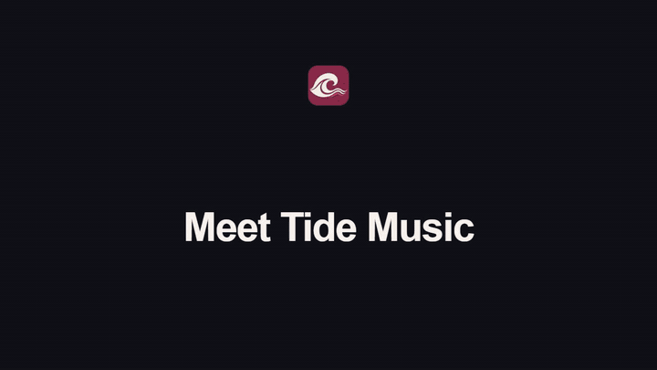

# Tide Music

A Windows-first native Rust music player designed to leave resources available for games.

## Product demo

[](docs/media/tide-product-demo.mp4)

[Watch the full 30-second video](docs/media/tide-product-demo.mp4) · [Edit the Remotion project](video/README.md)

The demo is a visual walkthrough of the current development prototype. Its native screenshots contain synthetic visual-test data, and playback is inactive. The composition uses [snapcn](https://github.com/shadcn-labs/snapcn) components.

**Working early prototype:** native interface, local/YouTube URL playback, search, queue controls and Windows media controls are implemented. YouTube URL playback and search use unofficial tooling and can fail when YouTube changes. Personal YouTube Music account/library sync is not implemented. This is not an official YouTube product.

## Design

- Full charcoal/burgundy library view.
- Earthy compact player with a text-first queue.
- Collapsed transport strip using the same queue and playback engine.
- Native Slint interface; no embedded browser or Electron runtime.


These are native screenshots with explicitly selected visual-test metadata; playback is inactive in the screenshots. Abstract cover art is a vector placeholder, not fetched album artwork. Earlier design references are in `docs/concepts/`.

## Build and run

Install stable Rust from [rustup](https://rustup.rs/). On Windows the normal MSVC toolchain requires Visual Studio C++ Build Tools. The repository also supports a development-local GNU setup through `scripts/cargo-local.ps1` when those tools are already present under the ignored `.tools` directory.

```powershell
pwsh -File scripts/setup-runtime.ps1
cargo run -p tide-music
```

The setup script downloads mpv, yt-dlp and Deno into `.tools/runtime`; it does not alter system PATH, register startup tasks or read browser credentials. Alternatively place trusted binaries in `tools/` beside the application, set `TIDE_RUNTIME_DIR` to their directory, or use PATH. mpv is the native audio engine; yt-dlp/Deno handle the current YouTube extraction requirements. Ordinary local playback only needs mpv.

Paste a supported http/https media link, enter a YouTube search query, or open an audio file. Search currently adds up to eight results to the queue; select a row to play. Use mode controls to switch between full, compact and collapsed views. The prototype saves queue metadata and preferences under the current user's application-data directory; it does not save account credentials or automatically download a music library.

## Resource use

The default software renderer avoids GPU-driver startup overhead for this mostly static interface. Include mpv and any transient extractor/runtime processes in measurements. Mode switching releases the inactive interface; the audio engine stays shared. See [validation and measurements](docs/VALIDATION.md). A small executable or a native language alone does not prove lower RAM use.

## Checks

```powershell
cargo fmt --all -- --check
cargo test --workspace --locked
cargo clippy --workspace --all-targets --locked -- -D warnings
python scripts/check_public_files.py
```

Native screenshots: `cargo run -p tide-music -- --smoke-ui .local/screens --smoke-populated`. This shows and captures full, compact and collapsed views, then exits. Test sample metadata is confined to this explicitly selected smoke mode.

## Privacy and credentials

No application API key is required. Never commit keys, tokens, cookies, `.env` files or local credential files. The ignore rules and tracked-file scan provide defense in depth; they do not replace reviewing every commit. Search and link playback contact external providers; local file playback stays local. There is no analytics or automatic browser-cookie access.

Provider terms and access restrictions still apply. The app does not implement account bypass, ad suppression or DRM circumvention. Unofficial playback compatibility is not guaranteed.

## License

Tide's original source is MIT licensed. Slint and playback tools retain their own licenses; see [third-party notices](THIRD_PARTY_NOTICES.md). Binaries/toolchains are excluded from Git. See [implementation plan](docs/IMPLEMENTATION_PLAN.md) and [contributing guide](CONTRIBUTING.md).
