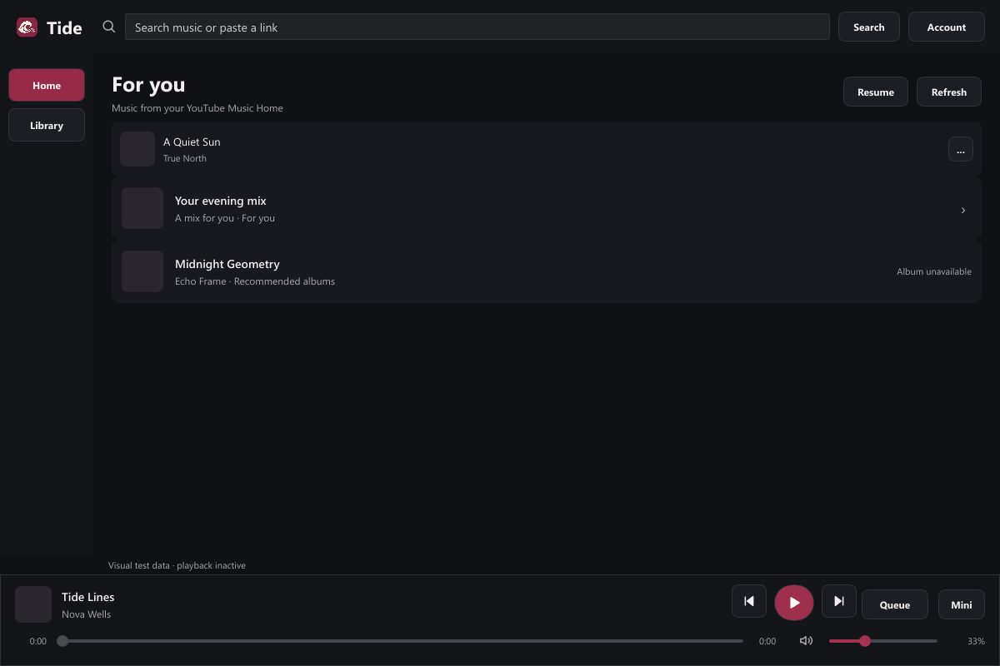
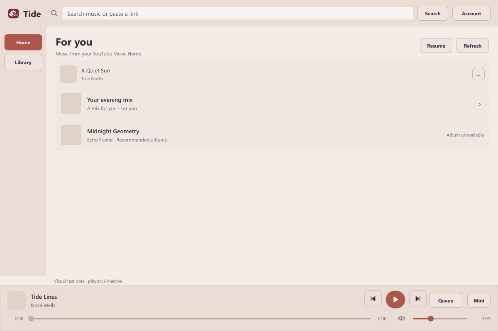
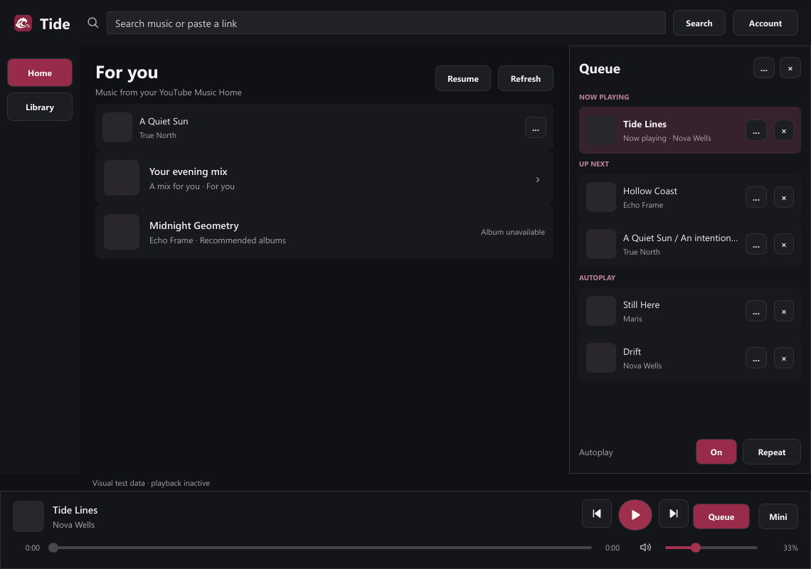
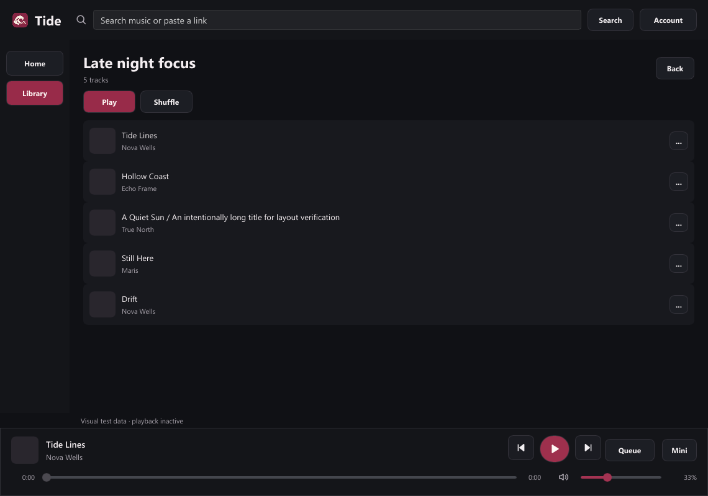
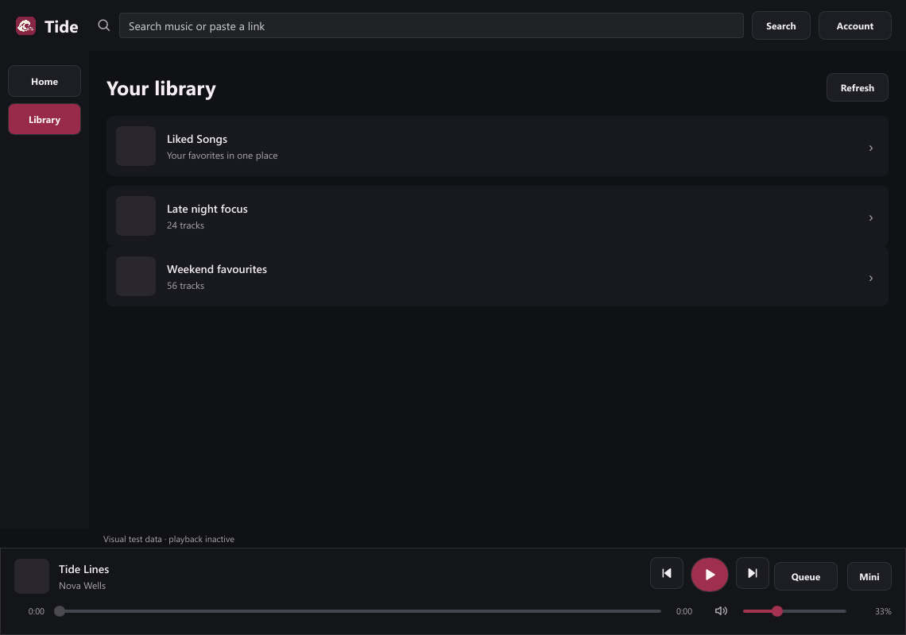

# Tide Music

A Windows-first native Rust music player designed to leave resources available for games.

**Working early prototype:** native interface, local/YouTube music playback, search, queue controls and Windows media controls. Optional account integration reads playlists, Liked Songs and recommendations and supplies your signed-in session to playback. Local signed-in library, Premium extraction and muted native playback have been verified; each installation still needs its own session. YouTube features use unofficial tooling and can fail when YouTube changes. This is not an official YouTube product.

## Design

- Home and Library as the two main destinations, with search in the header and an optional Queue drawer.
- Independent dark/light themes and full/compact sizing; the light palette uses warm grey, terracotta and muted purple.
- A mini player with a visible Restore button using the same queue and playback engine.
- Playlist previews with Play/Shuffle, song menus, upcoming-track reordering/removal, song radio and recommendation autoplay.
- Small real thumbnails with a bounded memory cache and no generic artwork banner.
- Native Slint interface; no embedded browser or Electron runtime.







These are native screenshots with explicitly selected visual-test metadata; playback is inactive in the screenshots. The screenshot fixtures omit artwork URLs; the live app fetches small provider thumbnails when available. Earlier design references are in `docs/concepts/`.

## Build and run

Install stable Rust from [rustup](https://rustup.rs/). On Windows the normal MSVC toolchain requires Visual Studio C++ Build Tools. The repository also supports a development-local GNU setup through `scripts/cargo-local.ps1` when those tools are already present under the ignored `.tools` directory.

```powershell
pwsh -File scripts/setup-runtime.ps1
cargo run -p tide-music
```

The setup script downloads mpv, yt-dlp and Deno into `.tools/runtime`; it does not alter system PATH, register startup tasks or read browser credentials. Alternatively place trusted binaries in `tools/` beside the application, set `TIDE_RUNTIME_DIR` to their directory, or use PATH. mpv is the native audio engine; yt-dlp/Deno handle the current YouTube extraction requirements. Ordinary local playback only needs mpv.

Paste a supported http/https media link, enter a YouTube search query, or open an audio file. Search currently shows up to eight results; select a song to play it or use its menu to queue it. Open Account for theme, window size and connection settings; its Advanced section holds manual import and help. Mini/Restore changes the player layout; theme changes preserve window size. Library playlists open a track preview with Play and Shuffle. Search results remain separate from the queue until selected. Playing a song or playlist preserves the browsing screen. Song menus expose Play next, Add to queue and Replace upcoming with song radio. Queue opens beside content at wide widths and overlays it at narrow widths; it separates manual tracks from autoplay suggestions and exposes reordering, removal, shuffle, repeat and Autoplay. Disabling autoplay removes upcoming automatic suggestions while preserving the current song and your choices. Autoplay requests recommendations from the current song when the queue is nearly finished; it requires a connected account and an available provider. The prototype saves queue metadata and preferences under the current user's application-data directory. For account features, install the optional helper with `scripts/setup-provider.ps1`, then choose **Account → Connect account** and select `cookies.sqlite` from your existing Zen profile. A manual session import is available as a fallback. See [local account setup](docs/ACCOUNT_SETUP.md). Sessions are encrypted with Windows DPAPI; your regular browser stays open and audio is streamed rather than downloaded as a library.

## Resource use

The default software renderer avoids GPU-driver startup overhead for this mostly static interface. Include mpv and any transient extractor/runtime processes in measurements. Mode switching releases the inactive interface; the audio engine stays shared. See [validation and measurements](docs/VALIDATION.md). A small executable or a native language alone does not prove lower RAM use.

## Checks

```powershell
cargo fmt --all -- --check
cargo test --workspace --locked
cargo clippy --workspace --all-targets --locked -- -D warnings
python scripts/check_public_files.py
python -m unittest discover -s helpers -p "test_*.py"
```

Native screenshots: `cargo run -p tide-music -- --smoke-ui .local/screens --smoke-populated`. Add `--smoke-library` for synthetic account/library metadata, and optionally `--fixture-audio path/to/silent.wav` to run native interaction assertions with a silent local file. This shows and captures Home, Library, playlist detail, search, account settings, Queue drawer, light/dark, compact and mini/restore views, then exits. UI smoke/benchmark modes never load your saved account session. The opt-in `--smoke-autoplay` check uses the existing encrypted session, mutes audio, tests native EOF advancing into song recommendations, then exits without saving its temporary queue or volume.

## Privacy and credentials

No application API key is required. Never commit keys, tokens, cookies, `.env` files or local credential files. The ignore rules and tracked-file scan provide defense in depth; they do not replace reviewing every commit. Search and link playback contact external providers; local file playback stays local. There is no analytics or automatic browser-cookie access.

Provider terms and access restrictions still apply. The app does not implement account bypass, ad suppression or DRM circumvention. Unofficial playback compatibility is not guaranteed.

## License

Tide's original source is MIT licensed. Slint and playback tools retain their own licenses; see [third-party notices](THIRD_PARTY_NOTICES.md). Binaries/toolchains are excluded from Git. See [implementation plan](docs/IMPLEMENTATION_PLAN.md) and [contributing guide](CONTRIBUTING.md).
