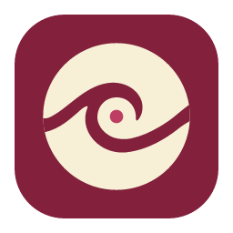
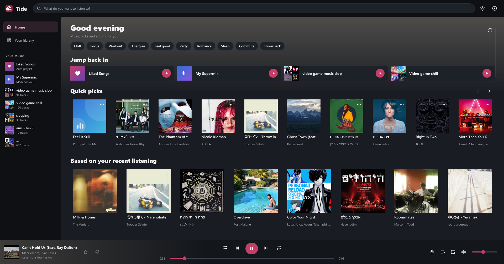
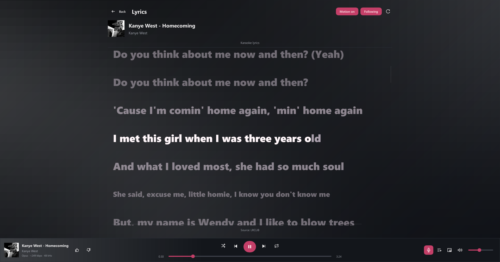
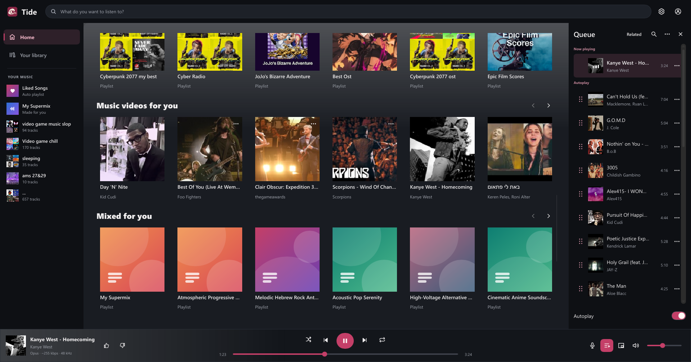
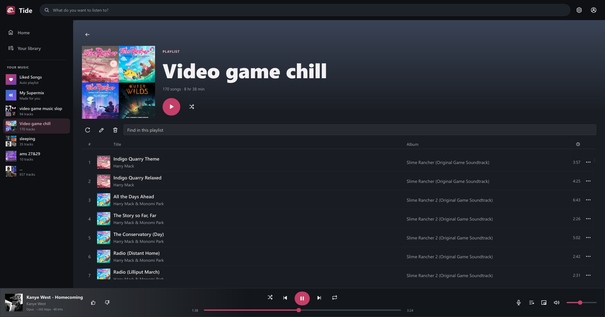
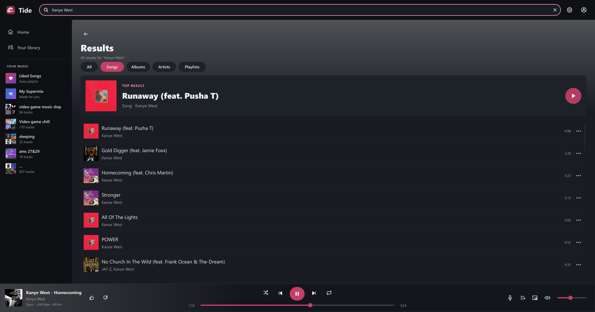
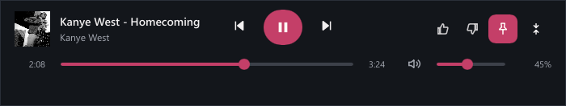

# Tide Music

**YouTube Music, without the browser.**
A fast, native player that stays light on RAM, even while you game.

 

---

## Why Tide

- 🪶 **Featherweight.** Native audio playback, with no embedded browser left running in the background.
- 🎮 **Made for gaming.** A pinnable mini player keeps music one click away without stealing your RAM or your screen.
- 🎧 **Your real library.** Sign in with your YouTube Music account to get your playlists, Liked Songs, Supermix and recommendations.
- 🤝 **Jams.** Invite a friend, share one queue and listen together in sync.
- 🔒 **Private by design.** Your session is encrypted on your machine. No Tide account, no analytics and no crash uploader.

## A closer look

<table>
  <tr>
    <td width="50%"> <b>Karaoke lyrics</b>: words light up in time with the song</td>
    <td width="50%"> <b>Queue</b>: drag to reorder while Autoplay keeps the music going</td>
  </tr>
  <tr>
    <td> <b>Playlists</b>: play, shuffle, edit and search inside any playlist</td>
    <td> <b>Search</b>: songs, albums, artists and playlists in one place</td>
  </tr>
</table>

   
  <b>Mini player</b>: pin it above your game and keep playing

## Features

| | |
|---|---|
| 🎵 **Play anything** | Songs, albums and playlists from YouTube Music, with native playback |
| 🎤 **Karaoke lyrics** | Word-by-word synced lyrics with smooth scrolling |
| 🏠 **Your YouTube Music** | Home recommendations, playlists, Liked Songs, saved albums and history |
| 📻 **Radio & Autoplay** | Start song radio or keep related music flowing automatically |
| 🧑‍🎤 **Artist pages** | Click an artist to play, shuffle or queue their top songs |
| 📋 **Smart queue** | Play next, drag to reorder, and search the queue or any playlist |
| 👍 **Like & save** | Like or dislike songs and edit your own playlists |
| 🔊 **Audio control** | Output device picker, bit-perfect exclusive mode, crossfade, equalizer, sleep timer and even volume |
| 🪟 **Mini player** | Compact one-row player that stays on top with adjustable opacity |
| ⌨️ **System integration** | Media keys, global shortcuts, trackpad swipes, macOS Control Center / menu bar and Discord status |
| 🔄 **In-app updates** | Updates download in the background; restart whenever you're ready |

## Get started

**Windows (x64)**

1. Download **[TideSetup.exe](https://github.com/yotam1001/tide-music/releases/latest/download/TideSetup.exe)** and install it. You don't need Rust, Python or an API key.
2. Click the profile icon → **Sign in with Google**, pick your Music profile, open Library, then click **Connect this profile**.
3. Search, open your Library or tap a Home recommendation. That's it.

If native sign-in isn't available, choose **Use browser companion instead**
([Chrome companion](https://github.com/yotam1001/tide-music/releases/latest/download/tide-browser-chromium.zip)).

**macOS (Sonoma 14 or later, preview)**

Download for [Apple Silicon](https://github.com/yotam1001/tide-music/releases/latest/download/Tide.dmg)
or [Intel](https://github.com/yotam1001/tide-music/releases/latest/download/Tide-Intel.dmg), then follow the
[Mac install guide](docs/INSTALLATION_MACOS.md).

📖 [Account setup](docs/ACCOUNT_SETUP.md) · [Installation](docs/INSTALLATION.md) · [Using Tide](docs/USING_TIDE.md)

## Listen together with Jams

1. Both of you install Tide and connect your own YouTube Music accounts.
2. Play a song, open **Jams**, then **Start Jam → Copy invite**.
3. Your friend pastes the invite into **Jams → Join Jam**.

Guests browse and press **+** to add songs, the host controls playback, and
everyone keeps their own volume. No browser needs to stay open. Jams use a free
shared relay by default, and **Advanced setup** lets you
[host your own](experiments/jam/README.md).

## Privacy

- Sign-in data is encrypted with Windows DPAPI or your Mac login Keychain.
- Tide has no account server, no analytics and no automatic crash uploads.
- Jams contact a relay only when you host or join one.
- Never share your cookies or session files with anyone.

[Full privacy details](PRIVACY.md) · [Security policy](SECURITY.md)

## Updates & help

On Windows, open **Settings → Check for updates**. Music keeps playing while the
update downloads, and you click **Restart to update** when you're ready. Your
accounts and preferences carry over. On Mac, replace Tide in Applications with
the new disk image ([details](docs/INSTALLATION_MACOS.md#updates)).

[Troubleshooting](docs/TROUBLESHOOTING.md) ·
[Report a bug](https://github.com/yotam1001/tide-music/issues/new) ·
[Remove Tide](docs/INSTALLATION.md#remove-tide)

## Contribute

Start from `main` and open your pull request against `main`. See the
[branch guide](CONTRIBUTING.md#which-branch-should-i-use) and the
[developer guide](docs/DEVELOPMENT.md). Maintainers can use the
[launch checklist](docs/BETA_RELEASE.md).

---

Tide is <a href="LICENSE">MIT licensed</a>. Dependencies keep their own licenses (<a href="THIRD_PARTY_NOTICES.md">third-party notices</a>). 
Tide is not affiliated with Google or YouTube.

