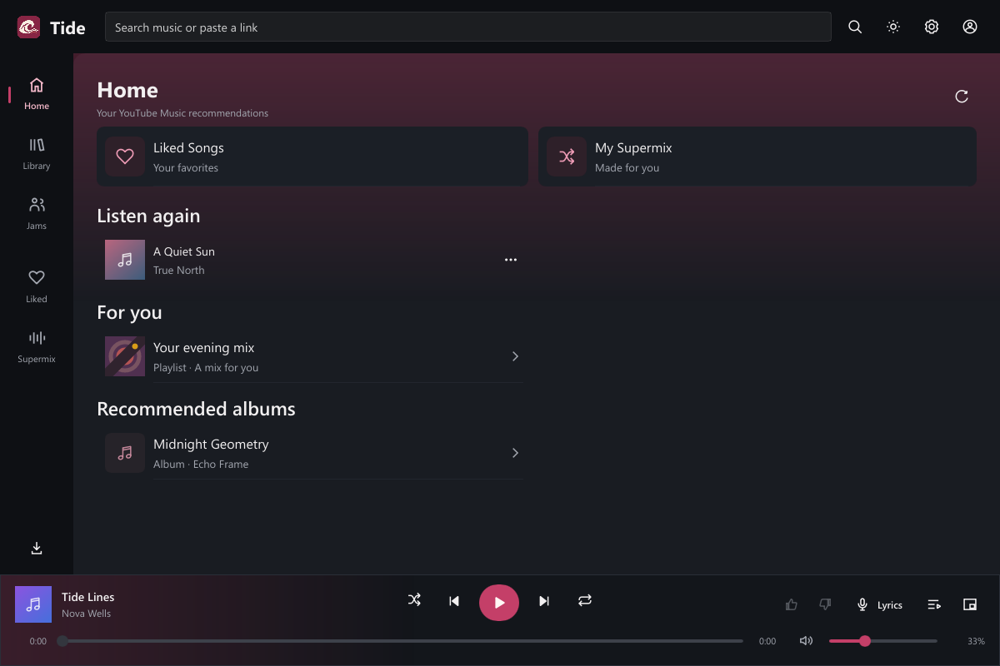

# Tide Music

A native Windows music player built to keep RAM use low while gaming.

[Watch the 48-second demo](docs/media/tide-promo.mp4)

The demo shows an earlier prototype; its memory comparison is one measured
example, not a fixed RAM guarantee.

Play YouTube Music, bring in your playlists and recommendations, and keep the
player out of the way with a mini mode. Tide uses native audio playback rather
than keeping an embedded browser running.

**Windows release:** [Download TideSetup.exe](https://github.com/yotam1001/tide-music/releases/latest/download/TideSetup.exe)
from [the latest stable release](https://github.com/yotam1001/tide-music/releases/latest).
Sign in from Tide's top-right profile icon after installation. The
[Chrome companion](https://github.com/yotam1001/tide-music/releases/latest/download/tide-browser-chromium.zip)
remains available as a fallback. The Windows installer is currently unsigned.

[Light theme](docs/screenshots/light.png)

Native search previews with fetched YouTube Music catalogue artwork.

## Get started

You need **Windows x64** and internet access. No Rust, Python installation or
API key is needed with the installer.

1. Download **TideSetup.exe** from the latest release and install Tide.
2. Open the profile icon → **Sign in with Google**. Choose your Music profile,
   open Library in the temporary window, then **Connect this profile**.
3. Search for music, open your Library, or choose a Home recommendation.

The login browser closes after connection. If native sign-in is unavailable,
choose **Use browser companion instead**. [Account setup](docs/ACCOUNT_SETUP.md) ·
[Installation](docs/INSTALLATION.md) · [Controls](docs/USING_TIDE.md).

## What you can do

- Open synced lyrics with smooth scrolling, animated line emphasis and an album-colour backdrop.
  Motion can be switched off; leaving lyrics, entering Mini or minimizing releases its extra view resources.

- Play songs, playlists and local audio with native playback.
- Search songs, albums, artists and playlists; browse saved albums and listening history.
- Search within playlists and the queue by title, artist or album.
- Choose Tide’s audio output and optionally smooth volume between songs.
- See small cover images in search, loaded through a bounded memory cache.
- Listen together in Jams: invite friends, share a queue and stay in sync.
- Select an artist name to browse their top songs, then play, shuffle or queue.
- See loading/retry feedback and the observed audio format in the player.
- See your playlists, Liked Songs and personalized recommendations.
- Like or dislike the playing song, and save or remove entries in your own playlists.
- Optionally send actual listening to YouTube Music history from Settings.
- Shuffle playlists, queue songs next, and drag upcoming tracks into order.
- Start song radio or enable Autoplay for related recommendations.
- Switch themes, resize the window or use a mini player.
- Use Windows media controls and download updates inside Tide; restart when ready.
- Optionally share the playing song with Discord.
- Pin the Mini player above other windows and adjust its opacity.

Theme is the sun/moon button in the header. **Account** is beside **Settings**.
**Queue** sits beside the player controls. [Learn the controls](docs/USING_TIDE.md)

## Listen together

Both people install the latest Tide and connect their own YouTube Music accounts.
Play a song, choose **Jams** below **Library**, then **Start Jam → Copy invite**, and send the invite to your
friend. They paste it into **Jams → Join Jam**. Guests can browse and press **+**
to add songs; the host controls playback. Your volume stays local.

No browser needs to remain open. The free shared server supports two rooms at
once and may take about a minute to wake. **Advanced setup** supports your own
server. Ending a hosted Jam keeps local music playing; leaving as a guest restores
your original queue paused.

## Connection and privacy

Native sign-in uses a separate temporary browser and stores the verified session
encrypted for your Windows user. The browser companion remains available as a
fallback. Jams contact a relay only when you host or join.

**Your existing account is used.** Tide reads your library; it does not move it
to another service or download your whole collection. Premium availability
depends on your account and the accessible streams. Tide does not provide
Premium, implement ad blocking, or guarantee every track or format.

**Your session stays local.** Saved sign-in data is encrypted for your Windows
user. There is no Tide account server, analytics or automatic crash uploader.
Never share cookies or session files. [Privacy details](PRIVACY.md)

**Memory use varies.** Include Tide and its temporary playback helpers when
comparing resource use. The [measurement notes](docs/media/memory-test.md) explain
the demo's figures. Installed Tide does not create Rust build caches.

## Updates and help

**Settings → Check for updates** finds published stable releases and offers
**Update Tide** with in-app progress and cancellation. Music continues until you
choose **Restart to update**; setup runs in the background. Startup checks can be
disabled. The updater skips beta
and draft releases. Installed previews can update to stable 0.1.3; future
preview-only updates still need their installer. Accounts and
preferences are kept during app updates. Update the unpacked companion separately
through its guide.

[Troubleshooting](docs/TROUBLESHOOTING.md) ·
[Report a bug](https://github.com/yotam1001/tide-music/issues/new) ·
[Remove Tide](docs/INSTALLATION.md#remove-tide)

Report security issues through [SECURITY.md](SECURITY.md), without publishing
private information.

## Contribute

See [Contributing](CONTRIBUTING.md) and the [developer guide](docs/DEVELOPMENT.md).
Release maintainers can use the [launch checklist](docs/BETA_RELEASE.md).

Tide's original source is [MIT licensed](LICENSE). Dependencies keep their own
licenses; see [third-party notices](THIRD_PARTY_NOTICES.md). Tide is not affiliated
with Google or YouTube.

## Experimental Jams development

Synchronized listening is developed behind the `experimental-jams` feature and
is excluded from the stable installer. See the [Jam guide](experiments/jam/README.md)
for the current developer setup and validation status.
