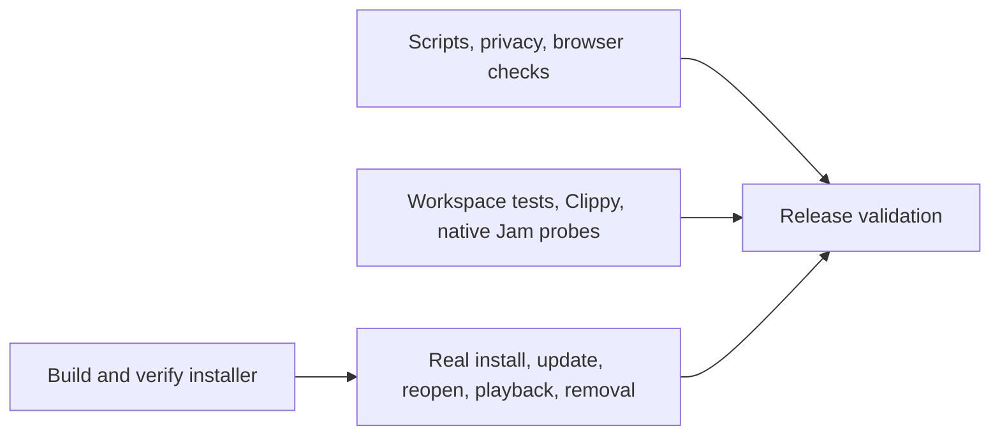

# CI and release validation

## Why it used to take longer

In the successful second attempt of [the 0.4.3 candidate](https://github.com/yotam1001/tide-music/actions/runs/40403121869), Windows checks took 16m28s, packaging took 5m23s, and installed-app validation took 2m43s. Those jobs ran serially. The installer/browser artifact uploads themselves took about four seconds. A script-fixture failure required repeating the entire Windows checks job.

Stable app defaults include `jams`, which includes `experimental-jams`. The old separate native-Jam job therefore repeated the app test suite and Clippy using the same effective features.

## Current pipeline

- Scripts, provider tests, privacy scanning and browser tests run separately from Rust. A failure can be retried without rebuilding Rust.
- The full workspace suite and Clippy run once with native Jams enabled. This includes the settings, header, playlist, queue, progress, volume and Jam UI tests. Private-input cancellation, dependency isolation and callback ownership probes reuse the same compiled output.
- Packaging and the real installed-app test run alongside code checks on isolated hosted runners. Passing packaging alone does not make a release ready.
- The standalone relay/container/native-clock jobs remain in the Jam workflow.
- PR commits run once through `pull_request`; branch pushes and tags do not trigger duplicate checks. Main pushes and explicit manual dispatch remain supported.
- New commits cancel obsolete runs of the same workflow/PR.
- Screenshot/evidence artifact names include the attempt number. Retrying packaging replaces only its generated CI archives, retaining their names for downstream installation checks.

Publication requires successful **Release validation**, successful applicable Jam workflow jobs, exact source/artifact matching, package/privacy checks and publisher-signature verification. Signing remains local to the maintainer; no publisher private key is placed in Actions. Published installers and tags are not overwritten by CI artifact replacement.

## Caching and disk use

Rust dependency caching stays on GitHub-hosted runners. Incremental builds remain disabled, and this change does not create a local `target` directory or turn on caching of workspace debug binaries. Rust dependency caches may be saved on failure so retries can reuse dependencies; every validation still runs.

## Measuring improvement

Compare successful runs at similar cache warmth. Measure the wall-clock interval from the first validation job starting to `Release validation` completing, and inspect individual step durations. The graph removes serial waiting and duplicate work; it does not guarantee a fixed runtime on shared runners. Keep queue delays and retries separate from successful validation time.
